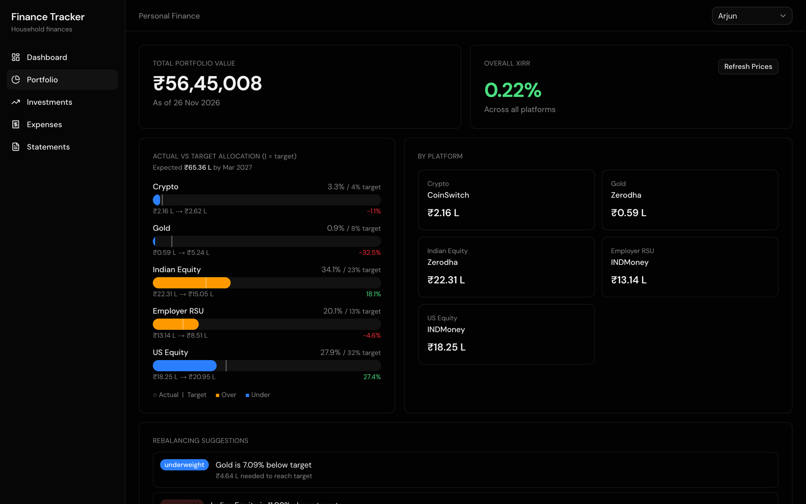
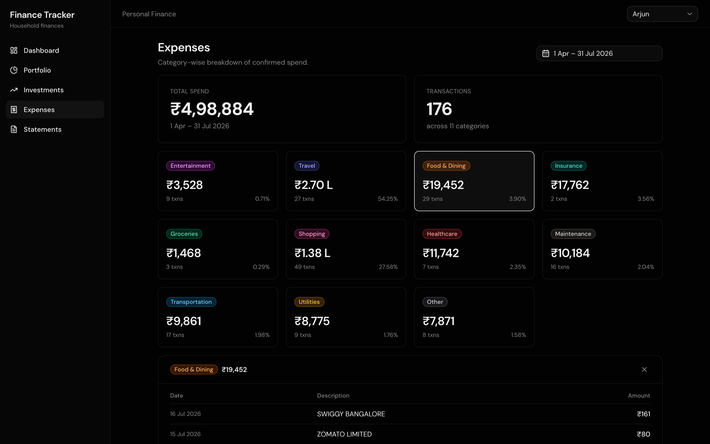
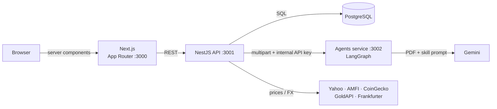
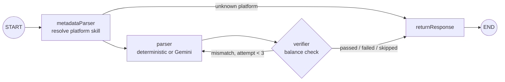

# Household Finance Tracker

**A local-first, statement-driven picture of one household's money: income, expenses and investments in one ledger, with AI agents that read the statements so nobody has to type them in.**

> Every bank, broker, fund house, crypto exchange and employee-stock portal has its own
> app, its own login and its own idea of what "your portfolio" means. The one thing they
> all produce is a **statement**. This project treats statements as the universal API for
> personal finance: upload the PDF/CSV/XLSX, let an agent extract every row, review it,
> and get a single, correct view of where the household's money is and where it is going.



<sub>Screenshots are from my own instance with **all amounts scaled by a hidden factor** and names, employer and merchants replaced. Percentages and proportions are unchanged.</sub>

---

## Why this exists

My household's money is spread across two salaried earners, several bank accounts, a
shared credit card with an add-on, Indian equities, US equities, mutual funds, crypto,
gold and employer RSUs/ESPP. Answering simple questions meant logging into eight apps
and reconciling them in a spreadsheet:

- *What is our net worth right now, in one currency?*
- *Are we over-allocated to one asset class compared with our target?*
- *What did we actually spend on food or travel last quarter, excluding money we just moved between our own accounts?*
- *What is our real annualized return (XIRR), per platform and overall?*

Off-the-shelf apps either want bank credentials (a no from me), don't understand Indian
instruments, or can't tell a credit-card bill payment from real spending. So I built the
tool I wanted: **private, runs on my laptop, and fed only by statements I download myself.**

## The plan

| Phase | Goal | Status |
| --- | --- | --- |
| **1. Ledger from statements** | Ingest bank, credit-card and investment statements into one double-checked ledger. Portfolio view with live prices, XIRR and target allocation. Expenses dashboard with category drill-down. | ✅ Built, in daily use |
| **2. Agents on top of the ledger** | **Portfolio-balancing insights:** an agent that watches allocation drift and planned investments and suggests concrete rebalancing moves. **Conversational finance:** ask "how much did we spend on travel this year vs last?" or "what if I move ₹X from Indian equity to US equity?" and get answers grounded in the confirmed ledger. | 🚧 Under build |

Phase 1 is the foundation the agents need: they're only as useful as the data underneath,
so every row is verified arithmetically and confirmed by a human before it counts.

---

## What it does today

### 📈 Portfolio
- Household-wide net worth across **Indian equity, US equity, mutual funds, crypto, gold and employer RSUs**, normalized to INR with historical FX rates
- **Actual vs target allocation**, including "expected total by date X" from planned monthly investments, so a category that looks on track today can still be flagged as falling behind
- **Rebalancing suggestions** with rupee gaps ("₹N needed to reach target")
- **XIRR** overall, per asset class and per platform (Newton-Raphson with multi-seed fallback for deeply negative returns)
- Live prices from Yahoo Finance (NSE/BSE/US), AMFI (mutual-fund NAVs), CoinGecko/CoinMarketCap (crypto) and GoldAPI, with caching

### 💸 Expenses



- Category-wise spend for any date range, with per-transaction drill-down
- **Transfer-aware:** credit-card bill payments, moves between household members and SIP debits are stored as transfers, not double-counted as spend
- Per-person attribution, even on a shared credit card statement where primary and add-on cardholder transactions are mixed together

### 📄 Statements: upload → agent → review → ledger
- Upload a statement for a known platform; the agent service parses it and returns rows, each with a **confidence score** and the **verbatim source text** it came from
- Rows land as `needs_review`. High-confidence expense rows from a statement that **passed arithmetic verification** auto-confirm; everything else waits for a human to confirm, edit or reject
- Reports only ever read `status = 'confirmed'` rows

---

## Architecture



Three independent processes, each with one job:

- **Frontend (`frontend/`)** renders. Server components fetch from the API, and there is no business logic in Next.js ([ADR-001](docs/decisions/ADR-001.md)).
- **Backend (`backend/`)** owns all business logic and **every database write**: dedup, person attribution, transfer handling, auto-approval, XIRR, pricing.
- **Agents (`agents/`)** turn a file into structured rows and nothing more. They never touch the database ([ADR-024](docs/decisions/ADR-024.md)).

---

## The agents

### `statements-parser`: a self-verifying extraction graph

Built with **LangGraph** ([ADR-022](docs/decisions/ADR-022.md)). The interesting part isn't the LLM call; it's the loop that checks the LLM's work.



1. **metadataParser** looks up the platform's *skill* in a static registry. Unknown platforms fail fast with HTTP 400 rather than guessing ([ADR-025](docs/decisions/ADR-025.md)).
2. **parser** runs either a deterministic column-mapped parser (CSV/XLSX) or Gemini with structured output (PDF). Gemini reads the PDF directly, with no PDF-parsing library ([ADR-023](docs/decisions/ADR-023.md)).
3. **verifier** recomputes the statement arithmetically: `opening ± transactions = closing` for bank accounts, the liability form for credit cards. On a mismatch, it loops back to the parser with the **prior attempt and the exact discrepancy** injected as retry context, up to 3 attempts.
4. **returnResponse** sends back rows plus `verificationStatus`. The backend uses it to decide what can auto-confirm.

### Skills: one per statement format

A skill is a small, testable unit: format, parser type, balance-check mode, a system prompt and few-shot examples.

| Skill | Format | Parser | Verification |
| --- | --- | --- | --- |
| Zerodha (Indian equity) | CSV | deterministic | — |
| INDMoney (US equity) | XLSX | deterministic | — |
| CoinSwitch (crypto) | XLSX | deterministic | — |
| Paytm Money (mutual funds) | PDF | Gemini | — |
| Employer stock (RSU / ESPP / options) | PDF | Gemini | — |
| HDFC Bank account | PDF | Gemini | opening/closing balance |
| ICICI Bank account | PDF | Gemini | opening/closing balance |
| HDFC Credit Card (primary + add-on) | PDF | Gemini | liability balance |

What the prompts are designed around:

- **Extract *every* row.** Prompts never say "exactly one element", which suppressed multi-transaction PDFs in practice.
- **Classify, don't just extract:** each row gets a `rowType` (expense / income / internal_transfer / investment / ignore). Transfers get a `transferType` (own account, household member, investment platform) so they never inflate spend ([ADR-011](docs/decisions/ADR-011.md), [ADR-026](docs/decisions/ADR-026.md)).
- **Calibrated confidence:** per-row confidence with explicit bands. Unfamiliar merchants go to "Other" with low confidence instead of a confident wrong category.
- **Household-aware, without hardcoding the household:** member names, named payees (landlord, housing society, parents) and the employer come from `agents/household.config.json`, which is gitignored. A fictional [`household.config.example.json`](agents/household.config.example.json) ships with the repo.

### Next up (Phase 2)

- **Portfolio insights agent:** reads confirmed holdings, targets and the planned-investment baseline, and proposes rebalancing moves with reasoning
- **Conversational agent:** natural-language questions answered from the confirmed ledger via tool calls into the backend, with no direct DB access, keeping the "backend owns data" boundary

---

## Stack

| Layer | Choice | Why |
| --- | --- | --- |
| Frontend | **Next.js** (App Router, server components), **shadcn/ui**, Tailwind CSS, **Recharts** | Server-rendered pages straight from the API; accessible components |
| Backend | **NestJS** (TypeScript) | Clear module → controller → service structure for the domain logic |
| Database | **PostgreSQL**, raw SQL via `node-postgres` + **pgtyped** | No ORM; typed queries; money as `NUMERIC(18,4)`, never float ([ADR-002](docs/decisions/ADR-002.md), [ADR-005](docs/decisions/ADR-005.md)) |
| Arithmetic | `decimal.js` | `NUMERIC` comes back as strings; no `parseFloat` on money |
| Agents | **LangGraph**, Express, **Google Gemini** (structured output) | Explicit, testable state machine around the LLM |
| Dev env | **Docker Compose** (postgres, backend, agents, frontend, CloudBeaver) | One command; nothing installed globally ([ADR-006](docs/decisions/ADR-006.md)) |

Some principles that shaped the code:

- **Immutable ledger.** Holdings are derived from transactions, using a running weighted-average cost that resets on full exit ([ADR-010](docs/decisions/ADR-010.md))
- **Staging by status, not by table.** Every row is `needs_review` → `confirmed` / `rejected`, and reports filter on `confirmed` ([ADR-004](docs/decisions/ADR-004.md))
- **Decisions are written down.** 26 ADRs live in [`docs/decisions/`](docs/decisions/)

---

## Running it locally

**Prerequisites:** Docker, Node 20+, a [Gemini API key](https://aistudio.google.com/apikey).

1. Copy the environment template and fill in your values:

   ```bash
   cp .env.example .env
   ```

   Set a strong random `INTERNAL_API_KEY`, for example:

   ```bash
   openssl rand -hex 32
   ```

2. Describe your household. Member names, named payees and your employer go here; this file is gitignored:

   ```bash
   cp agents/household.config.example.json agents/household.config.json
   ```

3. Start everything:

   ```bash
   docker compose up -d
   ```

4. Run the database migrations:

   ```bash
   cd backend && npm install && npm run migrate:up
   ```

5. Open http://localhost:3000. CloudBeaver (database UI) is at http://localhost:8978.

Tests:

```bash
cd agents && npm test
```

```bash
cd backend && npm test
```

## Privacy & security model

This is a **single-household, local-only** app, and the design leans into that:

- **No authentication, by design** ([ADR-003](docs/decisions/ADR-003.md)). Every container port is bound to `127.0.0.1`, so nothing is reachable from your network. Don't deploy it to a server as-is.
- **No bank credentials, ever.** Data comes only from statements you download yourself.
- **Statements never enter git.** `.env`, the household config, seed data and test statements are all gitignored.
- **Know what leaves your machine.** PDF statements are sent to the Gemini API for extraction; CSV/XLSX are parsed locally. Price lookups send only tickers. Review Google's data terms for your API tier before uploading real statements.
- The agents service only accepts requests carrying the shared `INTERNAL_API_KEY`, which is compared in constant time.

## Repository layout

```
agents/      LangGraph statement-parsing service (skills, parsers, verifier)
backend/     NestJS API: portfolio, investments, expenses, statements, pricing
  migrations/  SQL migrations (node-pg-migrate)
  scripts/     one-off historical seed scripts used to bootstrap the ledger
frontend/    Next.js app: dashboard, portfolio, investments, expenses, statements
docs/        system overview, ADRs, screenshots
SPEC.md      spec for the statement-ingestion agent
```

---

<sub>Built for my own household, shared in case the approach is useful to yours. Issues and ideas welcome.</sub>
